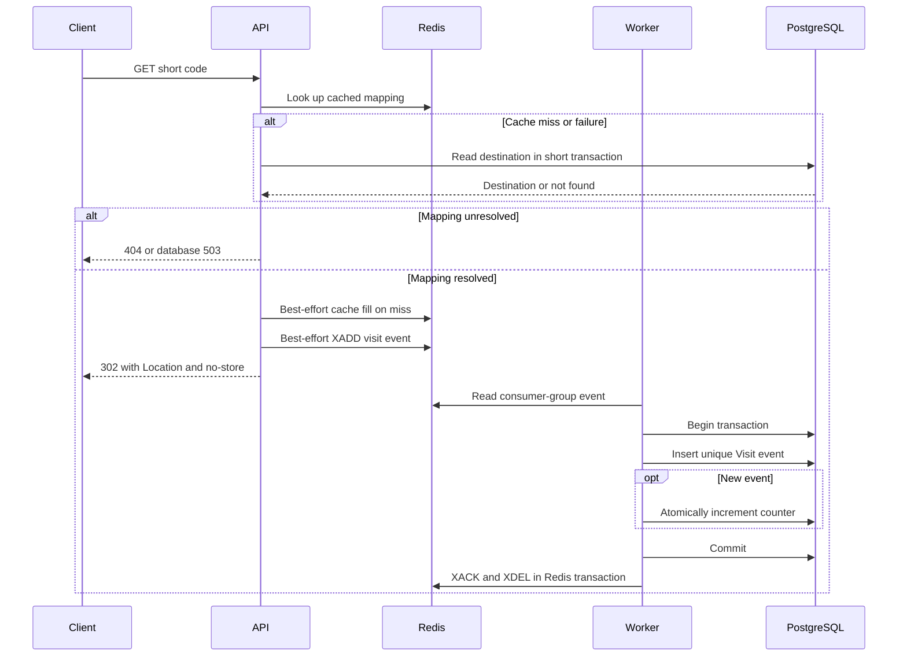

# Request and Worker Flows

These flows implement [requirements.md](requirements.md), [apis.md](apis.md), and
[entities.md](entities.md). API and worker run as separate processes. Expiration,
deletion, login, and synchronous visit persistence are outside scope.

## Shared responsibilities

The identity dependency parses trusted UUID headers. Each database operation uses
an async session and explicit transaction boundaries. Each process owns a pooled
engine and closes it on shutdown. API caching and queue publishing use separate
Redis connections; the worker has its own client and database sessions.

## Create — POST /shorten

Validate the URL and owner UUID, then allocate a PostgreSQL sequence value, encode
it as base62, skip reserved paths, and insert the mapping in a transaction. Commit
before `201`. Each successful request creates a distinct link with zero count.
Only primary-key code conflicts retry, after rollback; reserved candidates and
collisions consume the five-attempt budget. Invalid input returns `422`, allocation
exhaustion/database errors return `503`. Creation publishes no analytics.

## Redirect — GET /{short_code}

1. Capture the request UTC timestamp. Resolve the cached mapping without contacting
   PostgreSQL on a hit. On a miss/failure, read PostgreSQL and close that transaction
   before further Redis operations. A missing mapping returns `404`; a required
   but unavailable database returns `503`.
2. Construct `302` with `Location` and `Cache-Control: no-store`. Cache fills use
   a one-hour TTL and are best effort.
3. The decorator validates client IP metadata and builds one versioned event with
   a new UUID. Missing/invalid metadata skips publishing and logs a warning.
4. Attempt `XADD url-shortener:visits` once before returning, with 200 ms socket
   connection/read timeouts and no producer retries. Redis failure logs a warning
   but the resolved redirect still returns. Acceptance after a timeout is uncertain.
5. No Visit insertion, counter update, or other analytics database write occurs
   in the API. Cache hits can redirect even during PostgreSQL outages.

Repeated requests get different event IDs, even from the same IP. Unknown codes
on lookup, creation, statistics, and health publish nothing. A syntactically valid
stale cached mapping is trusted; its event can later fail reference validation.

## Worker — python -m url_shortener.worker

1. Create consumer group `visit-writers` at ID `0` with `MKSTREAM`, accepting an
   existing group. This includes events published before worker startup.
2. Each process uses a unique consumer name. Read one new event with `XREADGROUP`
   and a one-second blocking wait. Every five seconds, scan abandoned pending
   events using `XAUTOCLAIM` with a 60-second idle threshold.
3. Validate the versioned JSON payload. Missing event IDs/timestamps and malformed
   IPs/payloads are invalid; do not regenerate identity or time while consuming.
4. In one PostgreSQL transaction, insert the Visit with its producer event ID,
   code, IP, and timestamp. On duplicate event ID, insert nothing and do not
   increment. On a new insertion, increment the associated counter atomically.
5. Commit before `XACK` and `XDEL`, performed together in a Redis transaction.
   A crash or lost acknowledgement after commit can cause replay, not double-counting.
6. Database/Redis failures leave work unacknowledged and retry with exponential
   backoff from one to 30 seconds. Retain the current event during retries;
   another worker can recover it if this process dies.
7. Invalid events and absent mappings move to `url-shortener:visits:failed` with
   source ID, raw payload, and reason. Quarantine, acknowledge, and delete the
   original together. Quarantine entries are retained for inspection.
8. On SIGINT/SIGTERM, finish the current attempt when possible, stop reading,
   and close Redis and the engine. Forced termination leaves pending work recoverable.

The database counter equals processed unique Visit rows. Queue delivery is not
exactly once. Events can be missing after failed publishing or Redis persistence
loss, and counts can lag indefinitely while the worker is stopped.

## Statistics and health

Statistics validates the owner UUID, reads one PostgreSQL mapping/counter, enforces
ownership, and returns metadata and the committed processed count with `no-store`.
Return `404` for unknown mappings, `403` for another owner, `422` for invalid
identity, and `503` for database failures. Never read counters from Redis or scan
all Visit rows for this endpoint. A redirect need not be immediately visible.

Health still runs PostgreSQL `SELECT 1` and returns `200` or `503`. It checks
neither queue nor worker and emits no event; cached redirects can work while
this database readiness check fails.

## Operational guarantees

Run API and worker from the same version after applying migrations. Redis Streams
requires Redis 6.2+ for `XAUTOCLAIM`; use persistent storage, AOF with
`appendfsync everysec`, and `maxmemory-policy noeviction`. Do not apply cache-style
stream TTLs or trim unprocessed messages. Monitor pending count, oldest pending
age, backlog, publish failures, worker retries, and failed-stream length.

See [SCALABILITY.md](SCALABILITY.md) for batching alternatives, connection budgets,
queue durability, hot-counter limits, and campaign traffic handling.
