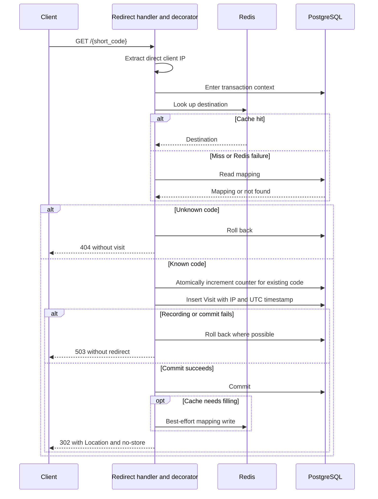

# Request Flows

These flows implement [requirements.md](requirements.md), [apis.md](apis.md),
and [entities.md](entities.md). Expiration and deletion remain outside scope.

## Shared responsibilities

FastAPI validates inputs and constructs responses. A replaceable dependency
parses the trusted `X-User-ID` as a UUID after trimming whitespace, rejecting
missing/invalid values with `422`. Authentication and a User table are deferred.

PostgreSQL owns mappings, UUID ownership, counts, and logs. Each request uses its
own async session; operations own their transaction boundaries. The application
creates one pooled engine and Redis client per worker and closes both at shutdown.
Static routes precede the catch-all redirect route.

## 1. Create a link — POST /shorten

1. Validate the UUID header and JSON body. Accept only an absolute HTTP/HTTPS
   destination with a hostname and at most 2,048 characters. Reject extra fields,
   whitespace/control characters in URLs, and invalid values with `422`.
   Do not contact or deduplicate destinations.
2. Begin a transaction. Allocate the next value from `short_code_sequence` and
   encode it with `0123456789abcdefghijklmnopqrstuvwxyzABCDEFGHIJKLMNOPQRSTUVWXYZ`.
   Start at 1, do not cycle, and skip reserved API path names.
3. Insert a ShortLink with the allocated code, submitted URL, supplied owner UUID,
   UTC creation time, and zero count. Never generate an owner UUID for the link.
4. Commit, then return `201` with code, destination, and creation time.

The database primary key enforces uniqueness. A conflict on `pk_short_links`
rolls back that attempt before another sequence value is allocated. Reserved
codes and collisions consume the five-attempt budget; exhaustion returns `503`.
Other integrity failures are not retried. Sequence gaps after failures are normal.
Creation needs no Redis and generates no Visit.

## 2. Follow a link — GET /{short_code}

### Resolve and record

1. The redirect-only decorator extracts a usable direct-peer IP, returning `503`
   if unavailable. Forwarded-header trust is deferred; documented Uvicorn commands
   disable proxy-header rewriting.
2. Enter one explicit transaction context before resolving. SQLAlchemy acquires
   database resources lazily; entering the context itself need not open a connection.
3. Look up `url-shortener:mapping:{short_code}` in Redis. On a miss, malformed
   value, or Redis error, read PostgreSQL. Unknown mappings return `404` with
   no Visit or counter increment.
4. The handler constructs the intended redirect, but the decorator does not
   release it yet. Atomically increment the existing ShortLink counter and insert
   the Visit in the same transaction. A cached mapping cannot authorize an
   orphan visit: if the update matches no database row, return `404` and attempt
   to evict the unusable cache entry.
5. Flush and commit both writes before returning the response. On database
   failure, roll back where possible and return `503` without a redirect. Do not
   blindly retry a commit whose outcome is unknown.
6. On a cache miss, attempt a mapping write with a one-hour TTL after commit.
   Expected Redis failures only produce diagnostic logs and do not suppress
   the committed redirect. Cache connection/read timeouts are 200 ms, without
   automatic retries.
7. Return `302`, `Location`, and `Cache-Control: no-store`.

Every redirect creates a separate Visit, including repeats from one IP. The
counter uses database-side arithmetic, avoiding lost updates under concurrency.
Counter and log consistency is transactional; client receipt is not part of the
commit guarantee. Background tasks are not used for required analytics.

## 3. Retrieve statistics — GET /stats/{short_code}

1. Parse `X-User-ID` as UUID; invalid/missing values return `422`.
2. Read the ShortLink directly from PostgreSQL through the request session.
   Return `404` for unknown codes and `403` if the UUID differs from the owner.
3. Return `200` with code, original URL, creation time, and aggregate count,
   plus `Cache-Control: no-store`. Database failures return `503`.

Statistics neither use Redis nor scan Visit rows. New links return zero. A fresh
READ COMMITTED query after a completed redirect includes that visit; concurrent
redirects not yet committed need not appear. The operation records no analytics.

## 4. Health — GET /health

Execute `SELECT 1` through a request-scoped PostgreSQL session. Return `200` with
`{"status":"OK"}` on success or `503` on database failure. This is PostgreSQL
readiness, not dependency-free liveness. It checks neither Redis nor identity and
records no Visit.

## Verification and limits

Unit tests mock session/cache boundaries. Disposable PostgreSQL/Redis checks
verify migrations, independent concurrent creations, exact Visit/counter totals
under concurrent redirects, rollback on forced Visit insertion failure, and
Redis outage fallback. No throughput benchmark is claimed.

A cache hit still writes PostgreSQL; it cannot make redirects available during
PostgreSQL outages. See [SCALABILITY.md](SCALABILITY.md) for hot-counter contention,
connection budgeting, analytics alternatives, and proposed scaling measures.
